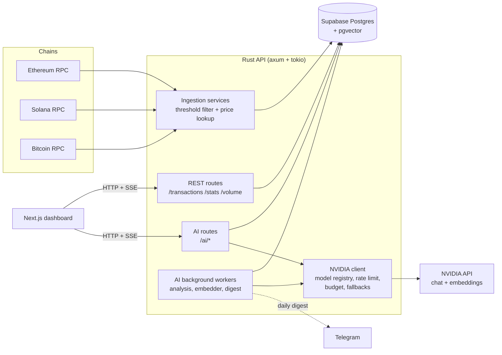
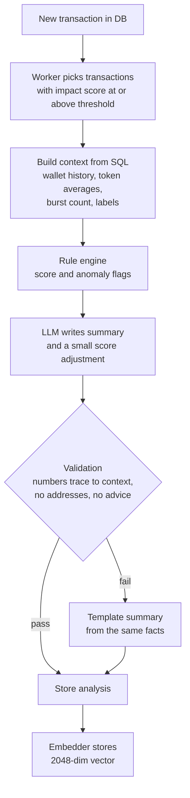
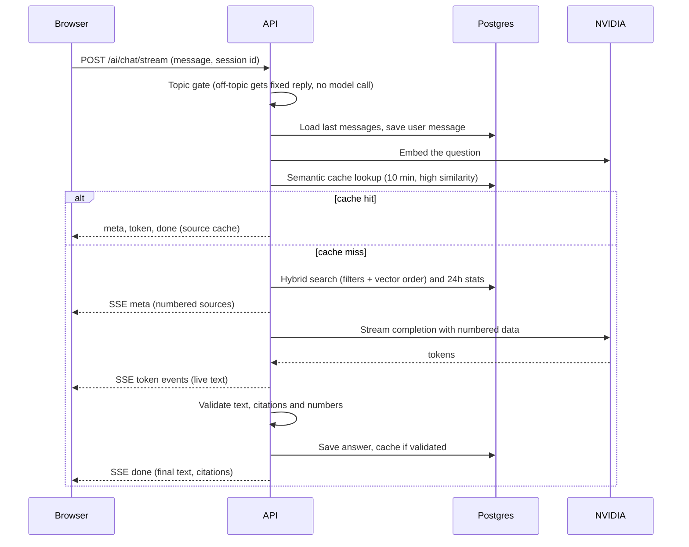

# TidalIQ

**Real-time large on-chain transaction tracking for Bitcoin, Ethereum and Solana, with a grounded AI layer on top.**

TidalIQ watches the three chains, saves every transfer above a size threshold, and shows them in a live dashboard. An AI layer then explains what happened: it writes a one-line summary for each transfer, scores its importance, flags anomalies, answers questions in plain English with citations, profiles wallets, and writes a market narrative. Every AI statement is checked against the stored data before it is shown.

> AI-generated insights, not financial advice.

---

## Features

**Tracking**
- Live ingestion of large transfers: Bitcoin (≥ $5M), Ethereum (≥ $1M), Solana (≥ $1M)
- Dashboard with a live alert feed, per-chain stats, volume vs. price charts, and chain and size filters
- Hash and address search, explorer links (Etherscan, Solscan, mempool.space)

**AI layer**
- **Transaction summaries** in plain language, generated once and cached by transaction hash
- **Importance score** (0–100, Low / Medium / High / Critical) from rules plus a small bounded model adjustment
- **Anomaly flags**: unusual size, first large move, rapid succession, token outlier
- **Natural-language search**: "big bitcoin transfers today", "ETH moves over $2M yesterday". The AI extracts validated filters, and semantic ranking orders the matches
- **Streaming chat** ("Ask TidalIQ") with numbered citations that link to the explorer, conversation memory, and a semantic cache
- **Wallet profiles** on demand, built from SQL statistics and your own wallet labels
- **Market narratives** over the last 6 or 24 hours, tying several transactions together
- **Daily digest** (optional) delivered to Telegram
- **Feedback**: thumbs up/down on summaries, chat answers, narratives and profiles
- **Safety rails**: topic gate, output validation, template fallbacks, daily token budget, per-client rate limit, feature flags

---

## Technologies

| Layer | Technology | Purpose |
|---|---|---|
| Backend language | Rust (2021 edition) | API server, chain ingestion, AI workers |
| Web framework | axum 0.8 on tokio | HTTP routes, Server-Sent Events streaming |
| Database access | sqlx (Postgres) | Queries and connection pooling |
| Database | Supabase Postgres | Transactions, AI tables, chat sessions |
| Vector search | pgvector (`halfvec(2048)` with HNSW cosine index) | Semantic search and semantic cache |
| HTTP client | reqwest (JSON, streaming) | NVIDIA API, chain RPC calls, Telegram |
| Ethereum | Alchemy RPC via alloy | Block and transaction ingestion |
| Solana | Solana RPC | Slot and transfer ingestion |
| Bitcoin | Bitcoin RPC | Block and transaction ingestion |
| LLM provider | NVIDIA API (OpenAI-compatible, build.nvidia.com) | Chat completions and embeddings, model list fetched live |
| Chat model | `nvidia/nemotron-3-super-120b-a12b` (with fallbacks) | Summaries, search parsing, chat, profiles, narratives |
| Embedding model | `nvidia/nemotron-3-embed-1b` (2048 dimensions) | Search and cache embeddings |
| Frontend | Next.js 16, React 19, TypeScript | Dashboard and AI interfaces |
| Styling and UI | Tailwind CSS 4, shadcn/ui (Base UI), lucide-react | Layout, components, icons |
| Charts | Recharts | Volume and price charts |
| Monorepo | Bun workspaces, Turborepo | Shared tooling and scripts |
| Shared package | `@tidaliq/shared` (TypeScript) | AI types, typed API client, chat stream reader |
| Notifications | Telegram Bot API (optional) | Daily digest |

---

## Architecture

### System overview



### Ingestion

Each chain has its own service running as a background task. It reads new blocks, converts native amounts to USD using the price service, keeps transfers above the chain's threshold, and writes them to the `transactions` table. A transfer already stored (same hash) is skipped.

### AI layer: how an answer is produced



The principle throughout is **grounding**: the model never reads raw chain data or invents facts. It receives a fact sheet computed in SQL, writes text, and the server rejects any output that contains a number that is not in the facts, a full address or hash, or trading advice. When validation fails, the user sees a plain template built from the same facts, never an unchecked answer.

### Chat request flow



### AI safety and cost controls

| Control | What it does |
|---|---|
| Output validation | Numbers must trace to the facts; citation numbers must exist; no addresses, hashes or trading phrases |
| Template fallback | If a model fails or is rejected, a factual template is used instead |
| Topic gate | Messages unrelated to transactions get a fixed reply with no model call and no search |
| Daily token budget | The client refuses calls once the day's budget is used |
| Shared rate limiter | One limiter keeps all model calls under the NVIDIA per-key request limit and honours `Retry-After` |
| Per-client limiter | Each API client is limited per minute on AI routes |
| Model fallback | Ordered candidate models; unavailable models are parked and skipped for a while |
| Feature flags | Search, chat, profiles and narratives can be switched off independently |
| Caching | Analyses by transaction hash, wallet profiles for 6 hours, narratives for 30 minutes, chat by semantic similarity for 10 minutes |

---

## Getting started

### Prerequisites

- Rust (stable) and Cargo
- Bun 1.3 or later
- A Supabase (or any Postgres) database with the `vector` extension
- An Alchemy key for Ethereum, plus Solana and Bitcoin RPC access
- An NVIDIA API key from build.nvidia.com (free tier works)

### 1. Database

Enable the vector extension and create the application tables. The AI layer adds these tables: `ai_analyses`, `ai_calls`, `tx_embeddings` (`halfvec(2048)` with an HNSW `halfvec_cosine_ops` index), `ai_semantic_cache` (same vector type and index), `wallet_labels`, `wallet_profiles`, `narratives`, `chat_sessions`, `chat_messages` and `ai_feedback`. The existing `transactions` table is not modified by the AI layer, apart from mirroring the summary, score and anomaly fields into its existing columns.

```sql
CREATE EXTENSION IF NOT EXISTS vector;
```

### 2. Backend configuration

Copy `.env.example` to `.env` in the API app and fill in the database URL, the chain RPC keys and the values below. Check `.env.example` for the exact names of the chain and database variables.

| Variable | Purpose | Example |
|---|---|---|
| `AI_ENABLED` | Master switch for the AI layer | `true` |
| `NVIDIA_API_KEY` | Your NVIDIA key | (secret) |
| `NVIDIA_BASE_URL` | OpenAI-compatible endpoint | `https://integrate.api.nvidia.com/v1` |
| `AI_FAST_MODELS` | Ordered chat models for light tasks | `nvidia/nemotron-3-super-120b-a12b,...` |
| `AI_STRONG_MODELS` | Ordered chat models for chat and narratives | `nvidia/nemotron-3-super-120b-a12b,...` |
| `AI_NO_THINK_MODELS` | Reasoning models that need thinking turned off | `nvidia/nemotron-3-super-120b-a12b` |
| `AI_EMBED_MODEL` | Embedding model (2048 dimensions) | `nvidia/nemotron-3-embed-1b` |
| `AI_RPM` | Requests per minute kept under the provider limit | `30` |
| `AI_DAILY_TOKEN_BUDGET` | Tokens allowed per UTC day | `400000` |
| `AI_COST_PER_1K_TOKENS` | Cost tracking (0 on the free tier) | `0` |
| `AI_MIN_IMPACT` | Minimum impact score for automatic analysis | `40` |
| `AI_FEATURE_SEARCH`, `AI_FEATURE_CHAT`, `AI_FEATURE_PROFILES`, `AI_FEATURE_NARRATIVES` | Feature flags | `true` |
| `TELEGRAM_BOT_TOKEN`, `TELEGRAM_CHAT_ID` | Optional daily digest delivery | (secret) |
| `AI_DIGEST_HOUR_UTC` | UTC hour (0–23) when the digest is sent | `3` |

Do not set `AI_EMBED_DIMENSIONS`: the default embedding model supports only its native 2048 dimensions. Never commit `.env`.

### 3. Run the API

```bash
cd apps/api
cargo run
```

You should see the database connection, the workers starting, the three chain services and `API running on http://localhost:4000`.

### 4. Run the web app

```bash
bun install          # from the repository root
cd apps/web
bun run dev
```

Set `NEXT_PUBLIC_API_URL` in the web app's environment if the API is not at `http://localhost:4000`.

---

## API reference

**Data**

| Method | Route | Description |
|---|---|---|
| GET | `/health` | Service status |
| GET | `/transactions` | Recent large transactions (`limit`, `chain`) |
| GET | `/transactions/{hash}` | One transaction |
| GET | `/stats` | Count and volume per chain |
| GET | `/volume` | Volume over time (`hours`, `bucket`) |
| GET | `/price-history` | Price history (`symbol`, `hours`, `bucket`) |
| GET | `/insights` | Top moves and anomalies in the last 24 hours |

**AI**

| Method | Route | Description |
|---|---|---|
| POST | `/ai/summarize-transaction` | Generate or refresh the analysis for a hash |
| GET | `/ai/transactions/{hash}` | Stored analysis: summary, score, tier, flags |
| GET / POST | `/ai/search` | Natural-language search (`q` or `query`, `limit`) |
| POST | `/ai/chat` | Chat answer as JSON |
| POST | `/ai/chat/stream` | Chat as Server-Sent Events (`meta`, `token`, `done`, `error`) |
| GET | `/ai/wallets/{chain}/{address}` | Wallet profile |
| GET | `/ai/narrative` | Market narrative (`hours` 1–48) |
| GET | `/ai/digest` | The 24-hour narrative |
| POST | `/ai/feedback` | Thumbs up/down (`kind`, `ref`, `helpful`, `comment`) |
| GET | `/ai/models` | Models discovered from NVIDIA and the ones selected |
| GET | `/ai/status` | Token use, latency and call counts |
| GET | `/ai/probe`, `/ai/probe-embed` | Diagnostics: test which models respond on your key |

---

## Design decisions

- **Grounded by construction.** Facts come from SQL; the model only phrases them. Validation is deterministic code, not another model.
- **Cache first.** Analyses are generated once per transaction, so repeated views cost nothing.
- **Live model discovery.** The NVIDIA model list is fetched at startup and every 6 hours. A catalogue entry does not guarantee access, so unavailable models are skipped automatically and a diagnostic route shows which ones work for your key.
- **No invented identities.** Wallet labels come only from the `wallet_labels` table you maintain. Everything else is "unlabelled".
- **Graceful degradation.** If the AI is off, over budget or failing, the dashboard still works and summaries fall back to templates.

---

## Known limitations

- Only native BTC, ETH and SOL transfers are tracked; token transfers such as stablecoins are not.
- "First large transfer" means the first one the tracker has seen, not the wallet's lifetime history.
- Wallet statistics key on the exact stored sender string, so a Bitcoin sender stored as `address (+N more)` is counted separately from the plain address.
- Search and chat times such as "today" and "yesterday" use UTC days.
- The AI routes have no authentication. Rate limiting trusts `X-Forwarded-For`, which is only safe behind your own proxy. Restrict CORS and add authentication before exposing the API publicly.
- Semantic search scans the filtered rows instead of using the HNSW index. This is fine at the current scale and should be revisited for much larger tables.
- The free NVIDIA tier is rate limited per key; heavy use will show up as fallback answers.

---

## Disclaimer

TidalIQ provides automated, AI-generated analysis of public blockchain data for information only. It is not financial, investment or trading advice. Wallet activity shown is limited to the large transfers TidalIQ tracks and does not represent complete on-chain history.